

  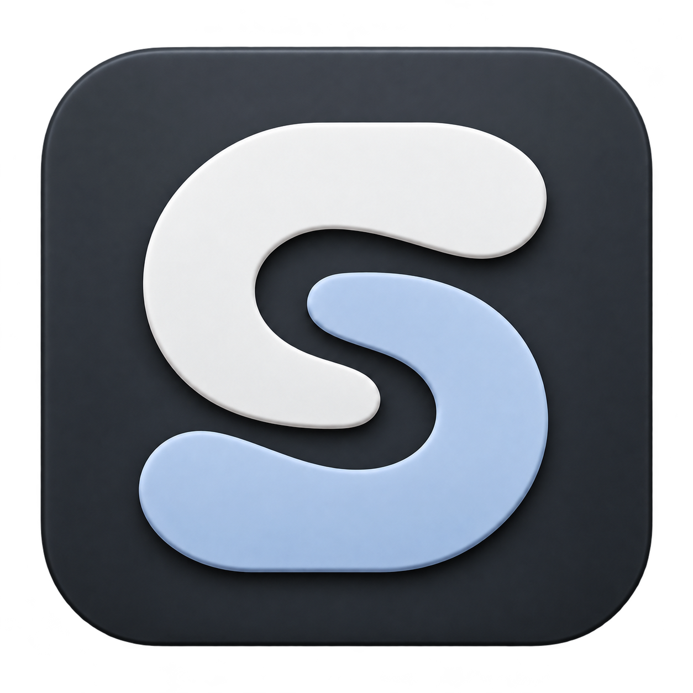
  <h1>随序 SUIRA</h1>
  
<strong>顺手接住，让工作继续。</strong>

  
一个快捷键，接住桌面上的截图、文字与灵感。 从收集、整理到下一步，让常用工具自然衔接。

  
Windows 11 x64 · 本地优先 · 当前版本 0.2.36

  
<a href="https://github.com/huihui200739/suira-updates/releases/latest">下载最新版本</a> · <a href="#开始使用">开始使用</a> · <a href="CHANGELOG.md">版本更新</a> · <a href="https://github.com/huihui200739/suira-updates/issues">反馈问题</a>

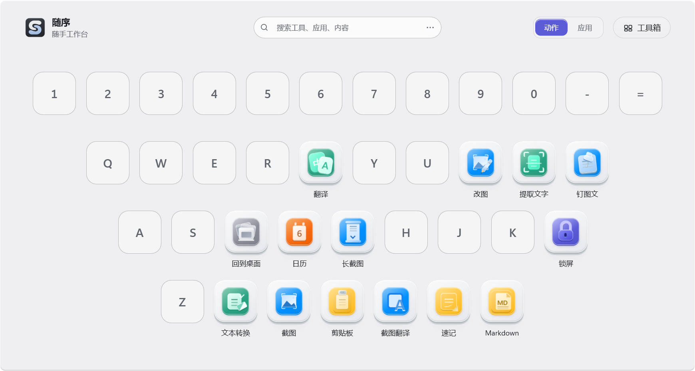

## 少一些切换，多一点连贯

随序把截图、文字和常用工具放进一张可自定义的键位面板。点击工具或按字母即可继续；按你的习惯绑定应用、网页、文件与文件夹，拖动换位，右键改绑。

| 收集 | 整理 | 继续 |
| --- | --- | --- |
| 区域截图、标注、手动滚动长截图 | 离线 OCR、文本转换、图片编辑 | 钉图文、复制与粘回当前窗口 |
| 文字、图片与文件剪贴板历史 | 任务匣、内容库与文件中转 | 按顺序收集、复制与导出 |
| 随手速记、日历待办与倒数日 | Markdown 文档与可折叠目录 | 沉浸编辑、源码、分栏预览与导出 |

**小窗口和全屏，同一套工具。** 保留 38 键的排列，按可用区域缩放；搜索条、菜单和工具箱共享玻璃材质与深浅配色。输入中文、拼音或首字母搜索本机应用；设置中开启“紧凑面板”，只显示已经绑定的键。

<table>
  <tr><td width="50%">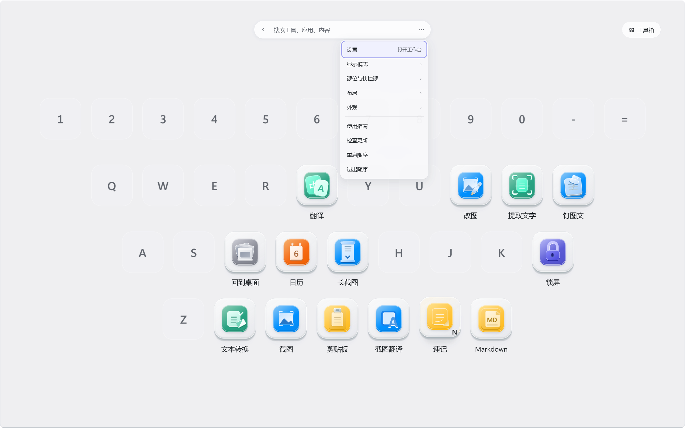</td><td width="50%">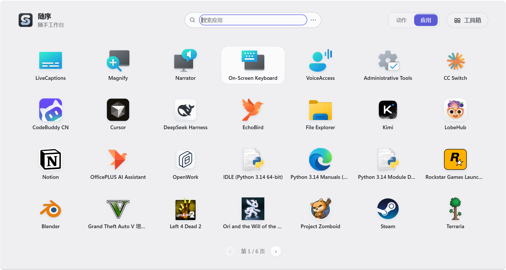</td></tr>
  <tr><td align="center"><b>全屏，保持熟悉的键位</b></td><td align="center"><b>应用，搜索后直接打开</b></td></tr>
</table>

**外观，随你选择。** 设置里可选雾白、墨夜、暖纸、松绿、午夜蓝，也能从桌面壁纸生成配色；强调色可独立跟随 Windows，玻璃浓度提供四档。所有窗口即时同步，明暗模式继续独立选择。

**文字，接着处理。** 翻译和文本转换共用一个窗口，切换标签即可继续。停止输入后自动翻译，结果可以接着整理、再次翻译，也可以回到上一步。

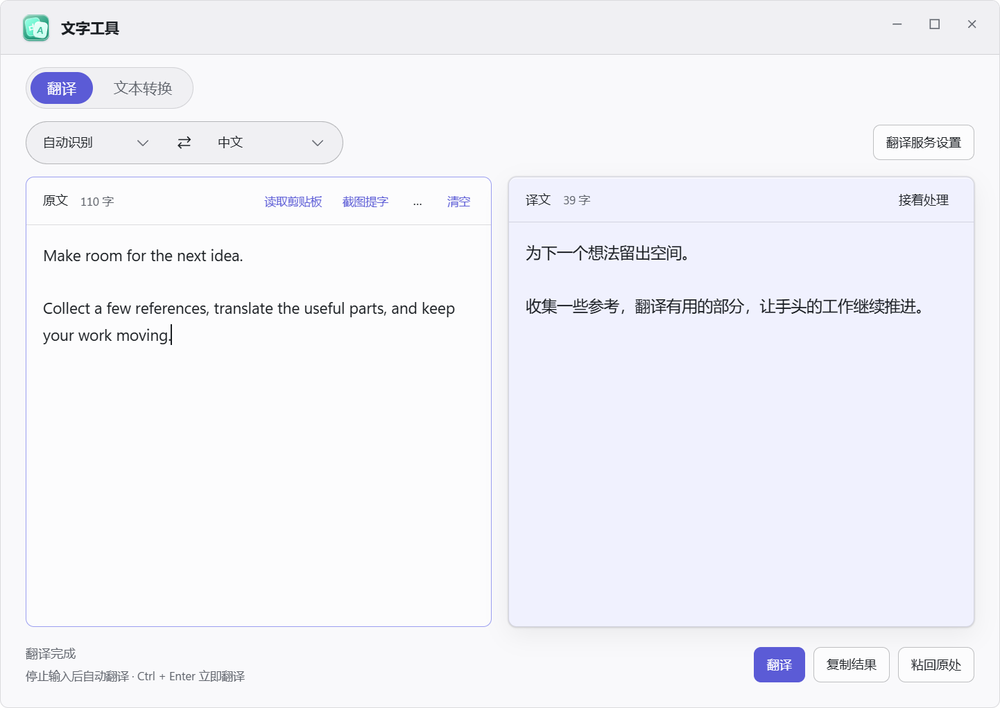

**零散内容，收进同一件事。** 任务匣把参考截图、文字和链接按顺序放在一起；内容库可搜索和预览已有资料。OCR 自动整理多余空行和汉字间空格，旧记录也以紧凑排版显示，原始文字保留。

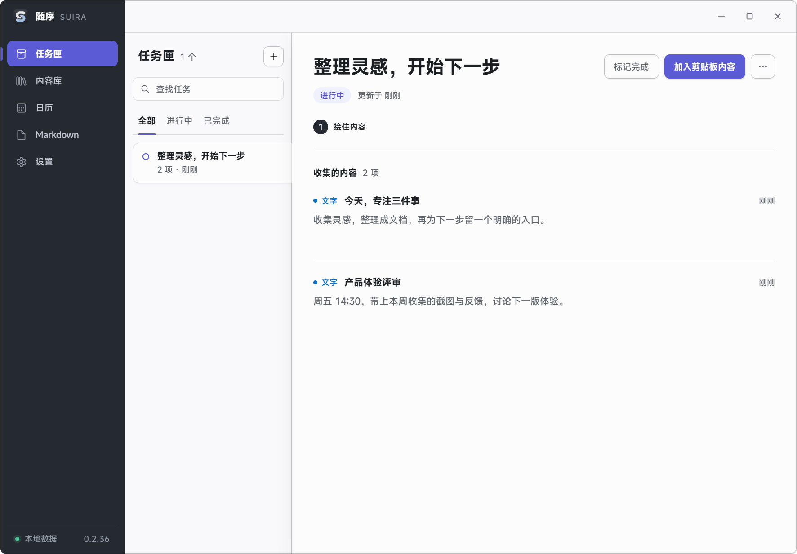

**过程，在内容旁边回看。** 在内容详情中展开处理轨迹，查看提字、整理、翻译和复制经过的每一步。原文、结果与错误放在一起，多次尝试收进同一步骤，失败后可以调整翻译或重试；用时按需展开。

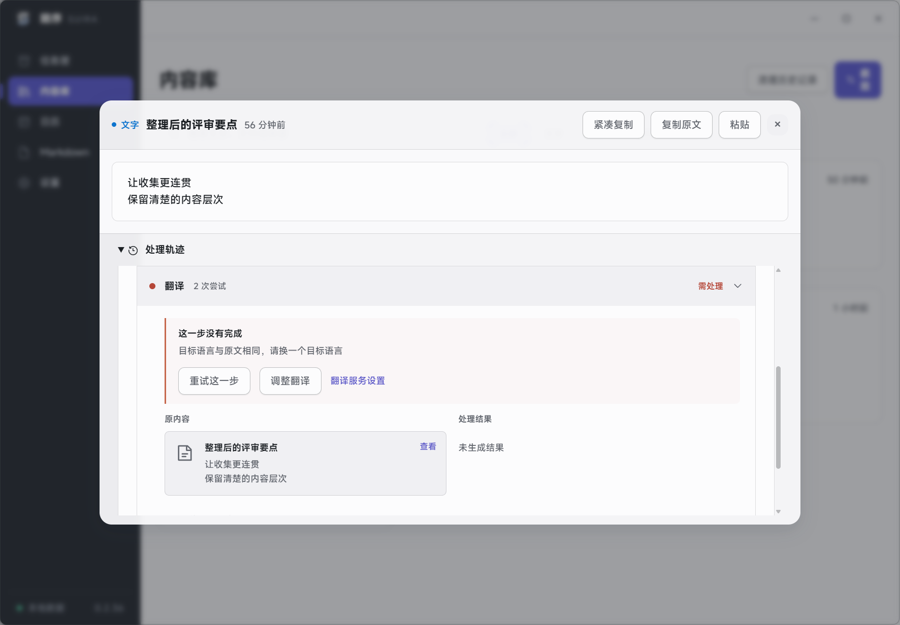

**写下来，再接着做。** Markdown 提供可折叠目录、各编辑模式通用的斜杠插入、格式操作、右键菜单及实时预览。速记自动保存，在真实背景玻璃上随手记录；日历集中显示农历、待办与重要日期。

<table>
  <tr><td width="50%">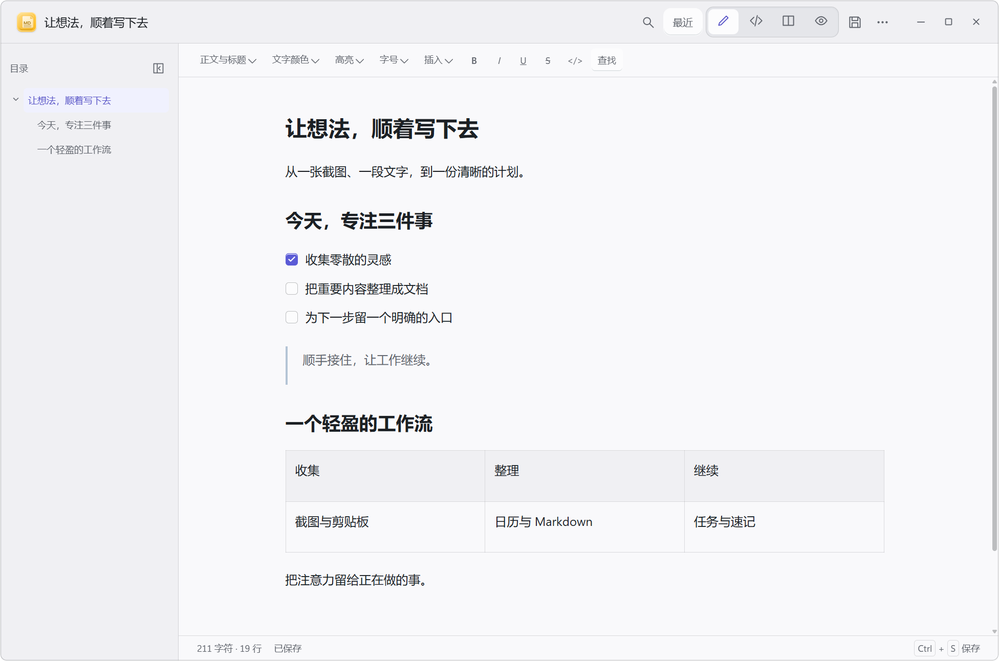</td><td width="50%">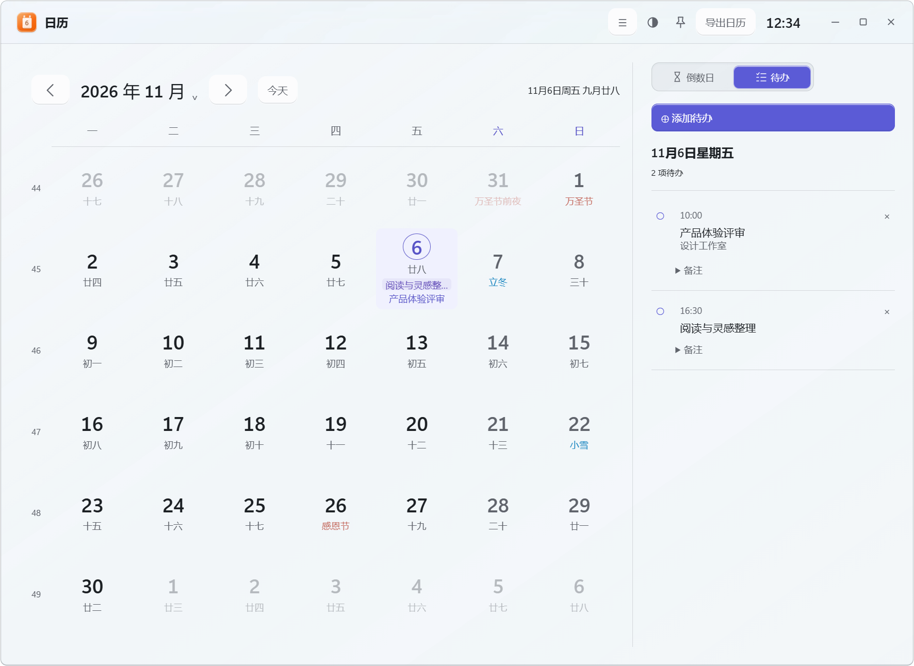</td></tr>
  <tr><td align="center"><b>文档，专注内容</b></td><td align="center"><b>日程，安排清楚</b></td></tr>
  <tr><td>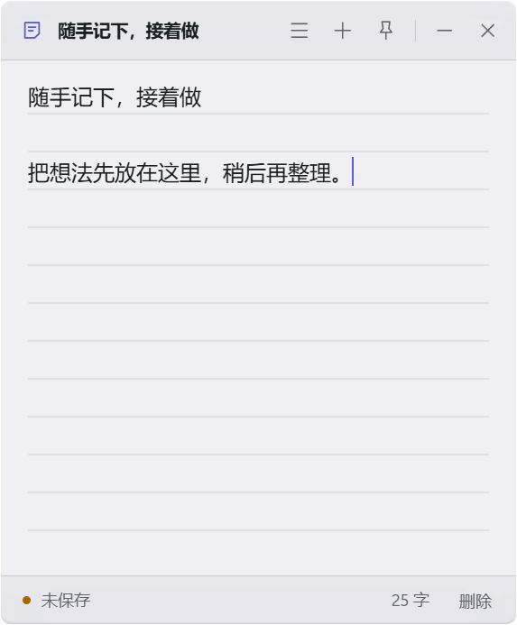</td><td>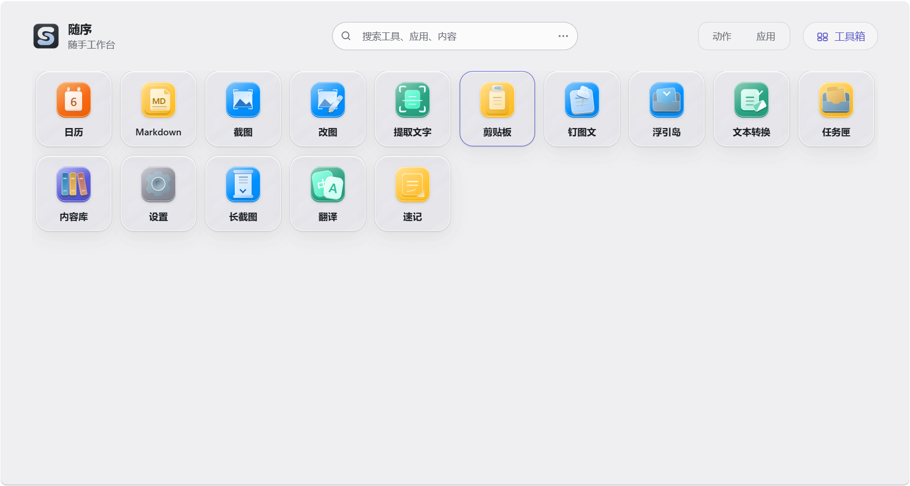</td></tr>
  <tr><td align="center"><b>速记，先接住想法</b></td><td align="center"><b>工具，随手可用</b></td></tr>
</table>

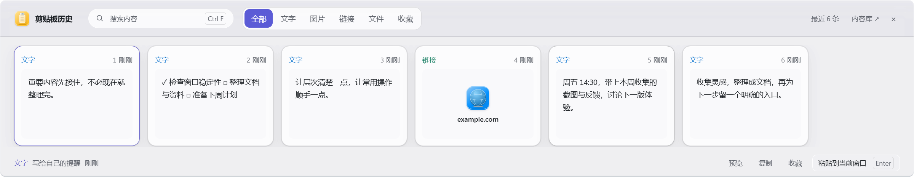

> 展示图来自当前版本的真实 Electron 页面，文档、日程和剪贴板均为独立演示数据。面板与速记的玻璃图使用受控测试背景，展示 Windows 原生实时模糊；没有嵌入静态壁纸。[截图说明](docs/product/README.md)

## 开始使用

支持 **Windows 11 x64**，当前正式版 **0.2.36**。从 [最新版本](https://github.com/huihui200739/suira-updates/releases/latest) 下载 `Suira-0.2.36-x64.exe` 并安装；已有安装版可在悬浮板三点菜单选择 **检查更新 → 下载更新 → 保存草稿并重启更新**。覆盖更新保留本机内容、键位和设置。

从托盘双击打开面板。全局快捷键默认关闭，可在设置中主动开启并调整冲突键位。

界面字体：MiSans（小米），原版字体用于主工作台；[MiSans 字体许可协议](https://hyperos.mi.com/font-download/MiSans%E5%AD%97%E4%BD%93%E7%9F%A5%E8%AF%86%E4%BA%A7%E6%9D%83%E8%AE%B8%E5%8F%AF%E5%8D%8F%E8%AE%AE.pdf)。

| 开启后的预设快捷键 | 功能 |
| --- | --- |
| `Alt+S` | 随手面板 |
| `Alt+C` / `Alt+G` | 截图 / 手动滚动长截图 |
| `Alt+V` | 剪贴板历史 |
| `Alt+F` / `Alt+M` / `Alt+N` | 日历 / Markdown / 速记 |

**内容保存在本机。** 无需账号，内容记录本地加密保存；离线 OCR 不依赖云服务。翻译在独立窗口中编辑、重译、复制或粘回原处，需要自行配置服务，提交时才发送选定文本。

**文档按自己的方式打开。** 可在 Windows「打开方式」中选择随序处理 `.md` / `.markdown`。编辑自动保存为随序草稿；`Ctrl+S` 写回原文件，检测到外部修改时拒绝覆盖。长截图需要手动滚动目标窗口，画面停稳后自动拼接。

安装包附带 `SHA256SUMS.txt` 供完整性核对，目前尚未代码签名。玻璃效果依赖 Windows 合成能力；系统要求减少透明度时使用实色底，保留文字可读性。

## 关于此仓库

这里分发随序的正式安装包、更新清单和产品说明。应用源码仓库保持私有；问题反馈请前往本仓库 Issues。
